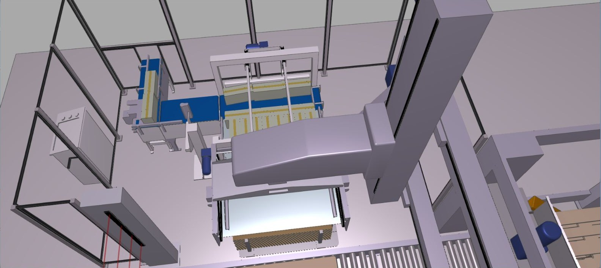
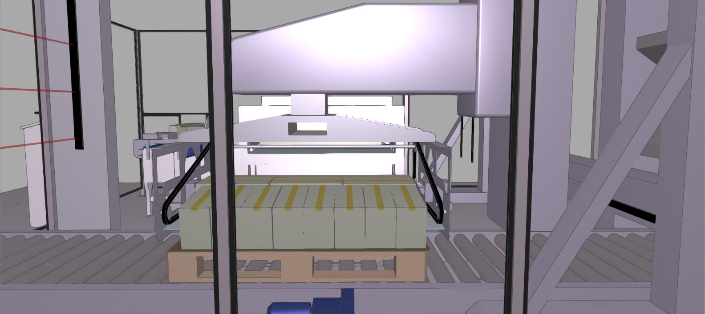
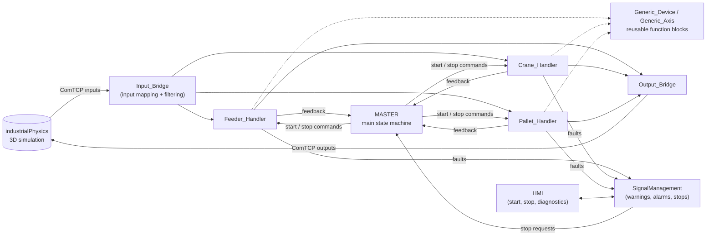
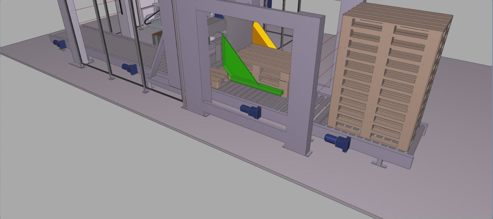
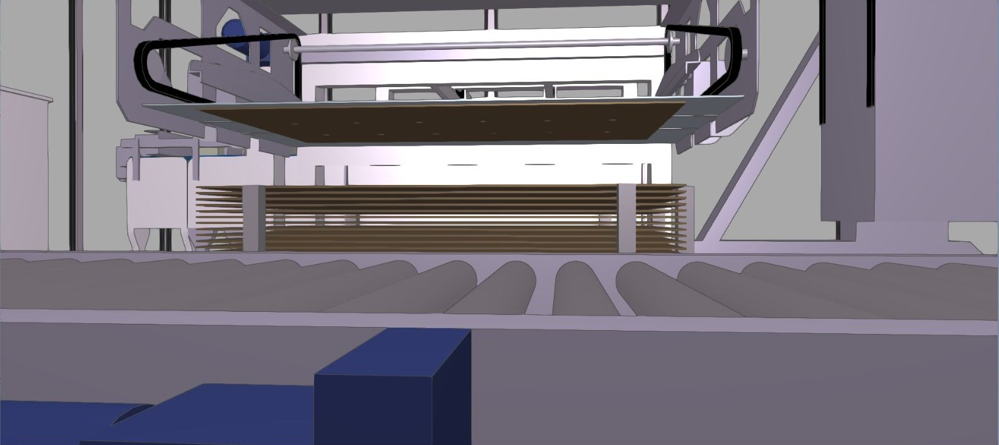

# MultiBox Palletizer: PLC Control Software and Simulation

Control software for a fully automatic multi-box palletizer, written in **IEC 61131-3 Structured Text** with **B&R Automation Studio** and tested against a 3D simulation of the machine in **industrialPhysics**.

The machine builds pallets of **two layers with 14 boxes each**, places a **cardboard sheet under every layer**, alternates the box orientation between layers and handles alarms, faults and three different kinds of stop.

> **Demo video:** [Watch the full cycle and the stop scenarios](https://youtu.be/YWUuxkhqDmY)



---

## 1. Project at a glance

| | |
|---|---|
| **Context** | University of Bologna, course *Automation Software and Design Patterns M* (team project) |
| **Platform** | B&R Automation Studio 4.10, Automation Runtime simulation, Visual Components HMI |
| **Language** | Structured Text (IEC 61131-3) |
| **Simulation** | industrialPhysics 3D model, connected to the PLC over TCP (`ComTCP`) |
| **Team** | Halil Öztürk and Santoshkumar Narayan Hankare |

### Results

- Complete palletizing cycle runs unattended: 2 layers x 14 boxes per pallet, with cardboard between layers
- Modular software: one state machine per machine unit, coordinated by a master state machine
- Three stop strategies (emergency, immediate, on-phase) plus fault-dependent stop categories
- Warnings and alarms for material shortage (cardboards and pallets) and for device faults
- Operator HMI to start/stop the machine, trigger stops and read diagnostics

---

## 2. The machine

The palletizer is made of three units:

| Unit | Function |
|---|---|
| **Feeder** | Takes boxes from the incoming conveyor, groups them into lines (pusher and turn-pusher) and delivers a group to the crane on a carriage axis |
| **Crane** | Gantry and box-crane axes with a vacuum gripper: picks a cardboard sheet, picks the box layer and places both on the pallet |
| **Pallet handler** | Lifter, fork and two pallet conveyors: supplies empty pallets, positions them under the crane and releases the finished pallet |



---

## 3. Software architecture

The code follows the design patterns taught in the course: timing, input bridge and filtering, a main FSM, subsystem FSMs, generic devices and axes, signal management, output processing and an output bridge.



### Programs

| Program | Responsibility |
|---|---|
| `MASTER` | Main FSM: sequences feeder, crane and pallet handler for layer 1 and layer 2, and reacts to every stop request |
| `Feeder_Handler` | FSM for conveyors, pusher, turn-pusher and carriage: counts boxes, builds a line and delivers it to the crane |
| `Crane_Handler` | FSM for gantry crane, box crane, vacuum gripper, slide rail and layer pushers: cardboard pick/release, layer transfer |
| `Pallet_Handler` | FSM for lifter, fork and pallet conveyors: pallet supply, positioning with light barriers, release |
| `SignalManagement` | Collects warnings, alarms and faults, assigns the stop category and drives the HMI lamps |
| `Input_Bridge` / `Output_Bridge` | Single place where simulation I/O is mapped to internal variables; includes input filtering |
| `Libraries/G_Device`, `G_Axis`, `G_SM` | Reusable *Generic Device*, *Generic Axis* and *Signal Handler* function blocks used by the handlers |

### Master state machine

```
Initialization -> WaitButtonStart -> WaitCheckHandlersStart
   -> WaitFeederFeedback -> WaitCraneFeedback -> WaitPalletFeedback        (layer 1)
   -> WaitFeederFeedback2 -> WaitCraneFeedback2 -> WaitPalletFeedback2     (layer 2)
   -> back to WaitFeederFeedback for the next layer pair
```

`WaitOnphaseStop` and `WaitStopSequence` handle the controlled stop paths.

### Stop strategies

| Stop | Trigger | Behaviour |
|---|---|---|
| **Emergency stop** | Emergency button on the HMI | Emergency flag to all three units; master returns to `Initialization` |
| **Immediate stop** | Immediate-stop button, or a device fault | All units halt at once; master waits for a new start |
| **On-phase stop** | On-phase button, or end of material | Units finish the phase they are in, then stop; the machine can resume afterwards without re-initialization |
| **Stop button** | Stop on the HMI | Immediate stop of all units, then re-initialization |
| **Fault categories** | Selected faults (`SM_IMMEDIATE_STOP_CAT1`, `SM_ON_PHASE_STOP_CAT1`) | Mixed strategy: for example the feeder stops immediately, while the crane stops immediately or on-phase depending on whether it is still receiving boxes |

### Signal management

- **Warnings:** last cardboard sheet or last pallet in the stack lights the *materials run out* lamp
- **Alarms with automatic reset:** cardboards or pallets finished, triggers an on-phase stop
- **Device faults:** every conveyor, pusher, turn-pusher, carriage, crane and lifter has a fault signal that triggers an immediate stop and can be cleared with a reset
- Initial stock in the simulation: 25 cardboard sheets and 5 pallets

### Input filtering

`Input_Bridge` latches the laser-sensor events (`LASER_SENSOR_IR_MEM`, `LASER_SENSOR_2_IR_MEM`) so that a box passing between two PLC cycles is never lost.

---

## 4. Demo

| Scenario | What it shows |
|---|---|
| **Full cycle** | Feeder, crane and pallet handler working together to build a complete pallet |
| **Emergency stop** | All units stop and the machine returns to initialization |
| **On-phase stop** | The machine finishes the current phase and then stops |
| **Material shortage** | Warning, then alarm, when cardboards run out |




---

## 5. Repository structure

```
multibox-palletizer/
├── README.md
├── docs/images/                  screenshots of the simulation
└── as-project/                   Automation Studio source (readable on GitHub)
    ├── Palletizer_Final_project_2.apj
    ├── Logical/
    │   ├── MASTER/               main state machine
    │   ├── Feeder_Handler/
    │   ├── Crane_Handler/
    │   ├── Pallet_Handler/
    │   ├── SignalManagement/
    │   ├── Input_Bridge/
    │   ├── Output_Bridge/
    │   ├── Libraries/            G_Device, G_Axis, G_SM
    │   └── Global.var            shared variables
    └── Physical/Config1/         hardware configuration
```

The complete Automation Studio project (including the HMI pages) is attached to the **Releases** section as a `.zip` file.

## 6. How to open the project

1. Download the full project `.zip` from the **Releases** page and extract it.
2. Open `Palletizer_Final_project_2.apj` with **B&R Automation Studio 4.10** or newer.
3. Build the project and start the Automation Runtime simulation.
4. To see the machine move, connect the simulation model in industrialPhysics through `ComTCP`. The 3D model was provided by the course and is **not** included in this repository.

## 7. My role

1. Programming the PLC
2. Defining the function blocks
3. HMI Design

## 8. Skills demonstrated

- PLC programming in Structured Text and state-machine design
- Modular architecture with reusable function blocks
- Fault handling, alarm management and safe-stop strategies
- Machine commissioning against a digital twin (simulation over TCP)
- HMI design for operator control and diagnostics

## 9. Acknowledgements

Project assigned in the course *Automation Software and Design Patterns M*, University of Bologna (Prof. Gianluca Palli). The task specification and the simulation model were provided by the course. Developed together with Santoshkumar Hankare.
